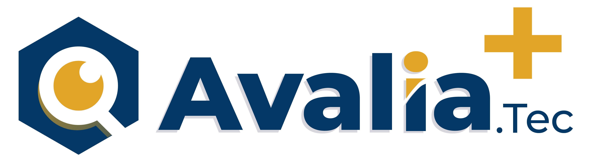

A integridade documental em processos de submissão e avaliação de projetos é um requisito crítico em ecossistemas de inovação. O Avalia+ é uma plataforma desktop multiplataforma, desenvolvida sobre o framework Electron, que integra submissão de projetos, avaliação cega por pares (*blind review*), geração de protocolos com hash criptográfico SHA-256 e painel administrativo com rastreabilidade completa de todas as interações.

{fig-alt="Interface da plataforma Avalia+" width="80%"}

## Arquitetura e serviços

A arquitetura do Avalia+ é organizada em 12 módulos de serviço independentes e orquestrados por um núcleo central. O serviço de autenticação utiliza BCrypt para hash de senhas com controle de sessão. O serviço de submissão processa os projetos com validação de CPF em tempo real, geração de PDF com protocolo único e hash SHA-256 verificável para cada documento submetido. O serviço de avaliação implementa o protocolo de *blind review* com anonimização automática e distribuição aleatória de avaliadores, garantindo imparcialidade e conformidade com diretrizes de avaliação institucional.

{fig-alt="Logo do Avalia+" width="40%"}

## Módulos complementares

O serviço de eventos gerencia editais e cronogramas com notificações automáticas. O serviço de recursos (*Appeal*) permite contestações formais com rastreamento de estado e prazos. O módulo de relatórios (PDFKit) gera documentos padronizados com estatísticas agregadas, distribuição de notas, rankings e certificados. O serviço de backup implementa política automática sobre banco SQLite com WAL (*Write-Ahead Logging*) para integridade transacional. O módulo de sincronização garante consistência de dados entre instâncias locais e repositório central. Os serviços de calendário, FAQ e publicação de arquivos completam o ecossistema operacional.

## Stack tecnológica

O Avalia+ é construído sobre Electron (v1.2.1), o que garante execução multiplataforma (Windows, macOS, Linux) a partir de uma base de código JavaScript unificada. O armazenamento local utiliza SQLite3 com WAL para operação offline resiliente. A geração de PDFs é feita por PDFKit, com integração de QR codes via qrcode.js para verificação rápida de autenticidade. A interface responsiva é renderizada em HTML/CSS com componentes reutilizáveis e acessibilidade WCAG 2.1.

## Resultados e impacto

A plataforma opera em produção desde 2024, tendo processado submissões de projetos de extensão e inovação com garantia de integridade e rastreabilidade. O sistema de hash SHA-256 permite que qualquer submissor verifique a autenticidade de seu protocolo de forma independente, enquanto o *blind review* elimina vieses na avaliação. A arquitetura modular permite adaptação a diferentes contextos institucionais com configuração mínima.

::: {.callout-tip}
## 📷 Sugestão de imagem
**avalia-tela-submissao.png** - Captura de tela do formulário de submissão com campos de projeto, validação de CPF e geração de protocolo.

**avalia-dashboard-admin.png** - Painel administrativo com estatísticas de submissões, avaliações em andamento e distribuição de notas.
:::

---

*Para saber mais sobre plataformas de gestão e inovação, confira também o [EviChain](/posts/projeto-evichain/) e nossas [publicações](/papers/). Visite os [projetos](/#projetos) para uma visão geral.*
