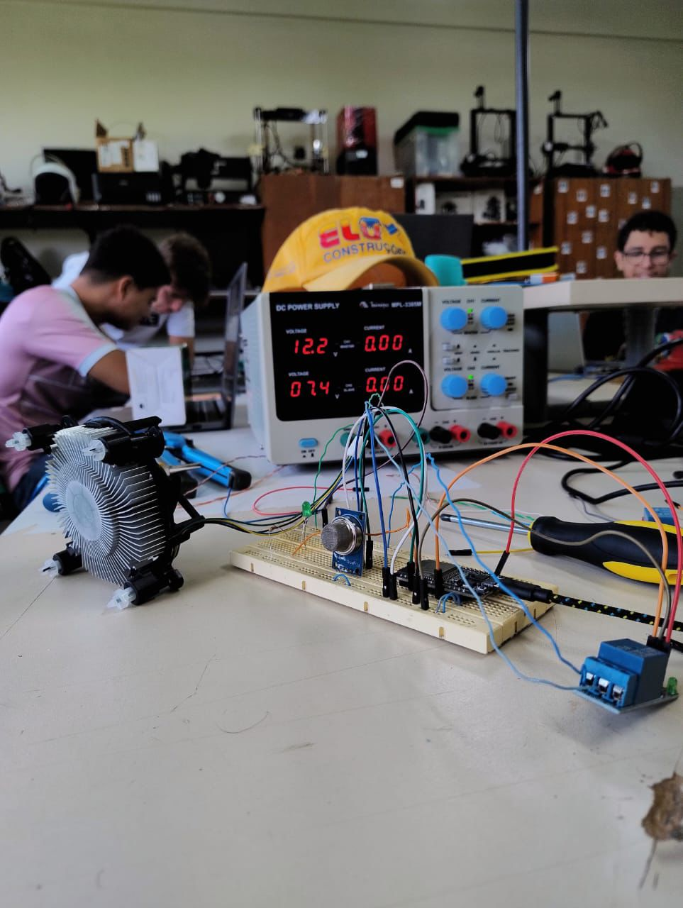
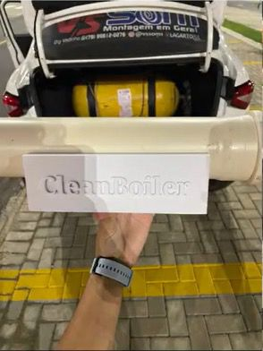
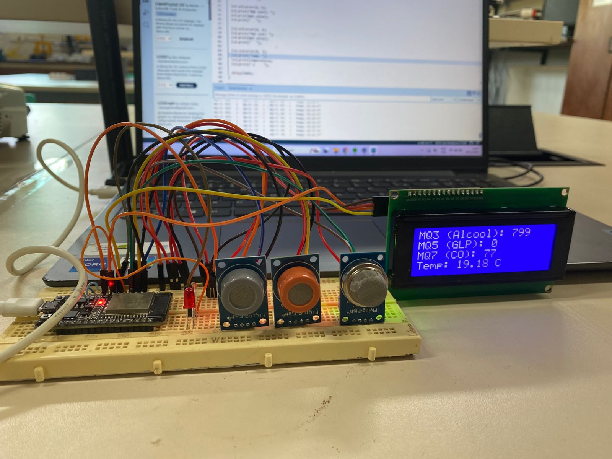
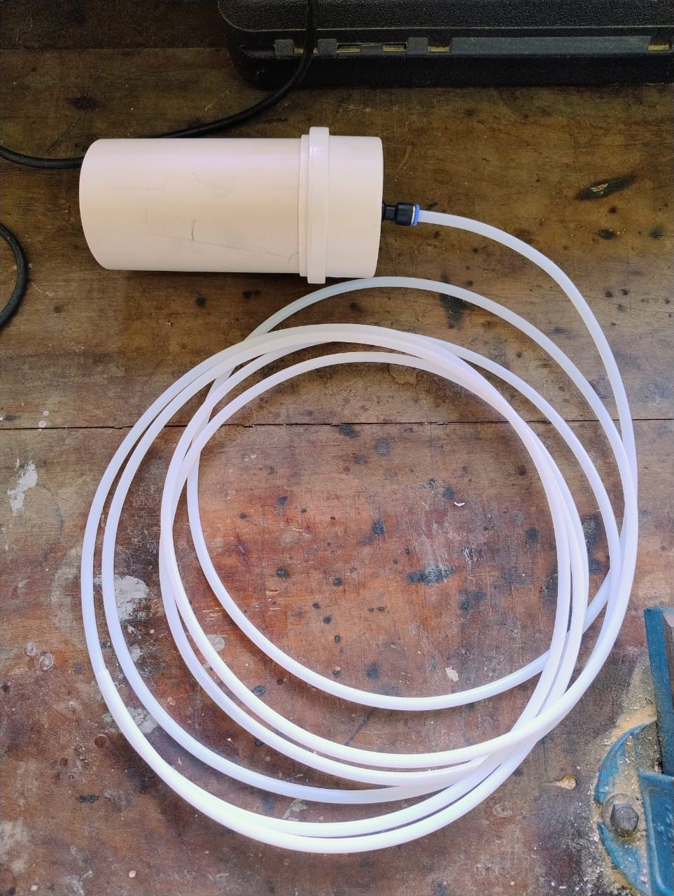

O monitoramento ambiental no Semiárido brasileiro opera sob restrições severas de infraestrutura, energia e conectividade que inviabilizam a aplicação direta de soluções de IoT desenvolvidas para ambientes temperados e urbanizados. O projeto CLEANBONER enfrenta esse desafio pela concepção de um sistema inteligente de aquisição, transmissão e análise de dados ambientais que combina sensores de baixo custo, protocolos de comunicação tolerantes à intermitência e algoritmos de processamento adaptados à sazonalidade e variabilidade extrema do clima semiárido.

{fig-alt="Sistema inteligente CLEANBONER de monitoramento ambiental" width="80%"}

## Arquitetura do sistema

O CLEANBONER opera em três camadas funcionais interconectadas. A camada de aquisição integra sensores de temperatura, umidade do solo e do ar, precipitação e radiação solar em uma estação compacta alimentada por painel fotovoltaico com bateria de backup. A camada de transmissão utiliza protocolos de baixo consumo energético para envio de pacotes de dados a intervalos configuráveis, com buffer local para operação em modo offline durante períodos de indisponibilidade de rede. A camada de análise recebe os dados em plataforma baseada em nuvem, aplica filtros de qualidade e algoritmos de detecção de anomalias, e disponibiliza painéis de visualização em tempo real para pesquisadores e gestores.

::: {layout-ncol=2}
{fig-alt="Componentes do sistema CLEANBONER"}

{fig-alt="Estação CLEANBONER em campo"}
:::

## Aplicação no monitoramento de NBS

O sistema tem sido testado como ferramenta de avaliação de desempenho das Soluções Baseadas na Natureza implementadas no Baixo São Francisco. Ao registrar continuamente variáveis como umidade do solo sob geossintéticos, escoamento superficial em parcelas experimentais e temperatura na interface solo-geotêxtil, o CLEANBONER permite quantificar a eficiência das intervenções com resolução temporal que métodos manuais não alcançam. A integração dos dados com modelos de balanço hídrico de parcela converte observações pontuais em estimativas distribuídas de desempenho.

{fig-alt="Área de monitoramento CLEANBONER em campo" width="80%"}

## Resultados e perspectivas

O protótipo funcional de IoT aplicado ao semiárido demonstrou a viabilidade operacional do conceito sob condições de campo, com taxa de disponibilidade de dados superior a 85% mesmo durante a estação seca. A autonomia energética do sistema, garantida pelo dimensionamento fotovoltaico com redundância de bateria, elimina a dependência de rede elétrica e viabiliza a instalação em áreas remotas. Os dados coletados alimentam diretamente as análises dos projetos de geotêxteis, geocompostos e revegetação, fechando o ciclo entre intervenção de campo e monitoramento de desempenho.

---

*Para saber mais sobre monitoramento ambiental e NBS, confira os posts sobre [Monitoramento Hidrológico e Geotecnologias](/posts/monitoramento-hidrologico/), [Retaludamento como NBS](/posts/nbs-retaludamento/) e [NBS e Custos de Mitigação](/posts/nbs-custos-mitigacao/). Visite também nossas [publicações](/papers/) e [projetos](/#projetos).*
