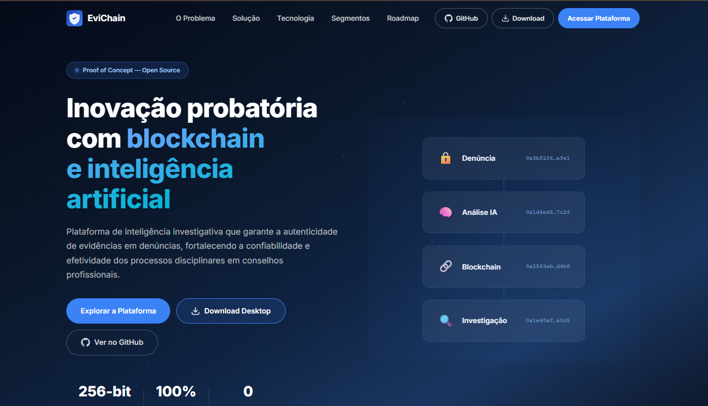

A gestão da cadeia probatória em processos de investigação e conformidade demanda sistemas que garantam imutabilidade, rastreabilidade e transparência de cada etapa documental. O EviChain é uma plataforma desktop que integra blockchain proprietária baseada em SHA-256, inteligência artificial (via OpenAI GPT) para análise automatizada de denúncias e um sistema completo de auditoria imutável, direcionado a conselhos profissionais, órgãos reguladores e equipes de compliance.

{fig-alt="Plataforma EviChain Desktop com blockchain e IA" width="80%"}

## Arquitetura e blockchain

O backend é construído sobre Flask (Python), com API RESTful servindo mais de 1300 linhas de lógica de negócio. A blockchain implementa encadeamento de blocos com hash SHA-256, onde cada ação (criação de processo, anexação de evidência, parecer, decisão) gera um bloco imutável vinculado ao anterior. A validação de integridade percorre toda a cadeia para detectar qualquer tentativa de adulteração. O armazenamento local utiliza banco de dados relacional com transações ACID para consistência dos registros.

## Inteligência artificial integrada

O módulo de IA utiliza a API da OpenAI (GPT) para análise automatizada de denúncias, classificação de gravidade, extração de entidades e sugestão de encaminhamentos. O sistema processa textos em linguagem natural e gera relatórios estruturados que auxiliam investigadores na triagem e priorização de casos. A integração é feita por chamadas assíncronas à API com gestão de tokens e fallback para operação offline.

## Funcionalidades operacionais

O EviChain oferece gestão completa do ciclo de vida processual, com criação de processos, registro de denúncias, anexação de evidências com verificação de integridade, emissão de pareceres, aprovação por comissão e geração de relatórios auditáveis. O sistema de autenticação suporta múltiplos perfis (investigador, auditor, gestor) com controle granular de permissões. A interface PWA (*Progressive Web App*) garante responsividade e operação fluida em desktop.

## Aplicação e público-alvo

O sistema é direcionado a conselhos profissionais (CREF, CRM, OAB), órgãos de fiscalização e empresas com necessidade de conformidade regulatória. A prototipagem avançada (TRL 6) demonstra a viabilidade técnica da integração blockchain-IA para garantia de integridade probatória em ambientes institucionais.

---

*Para saber mais sobre plataformas de gestão e tecnologia, confira também o [Avalia+](/posts/projeto-avalia-mais/) e nossas [publicações](/papers/). Visite os [projetos](/#projetos) para uma visão geral.*
