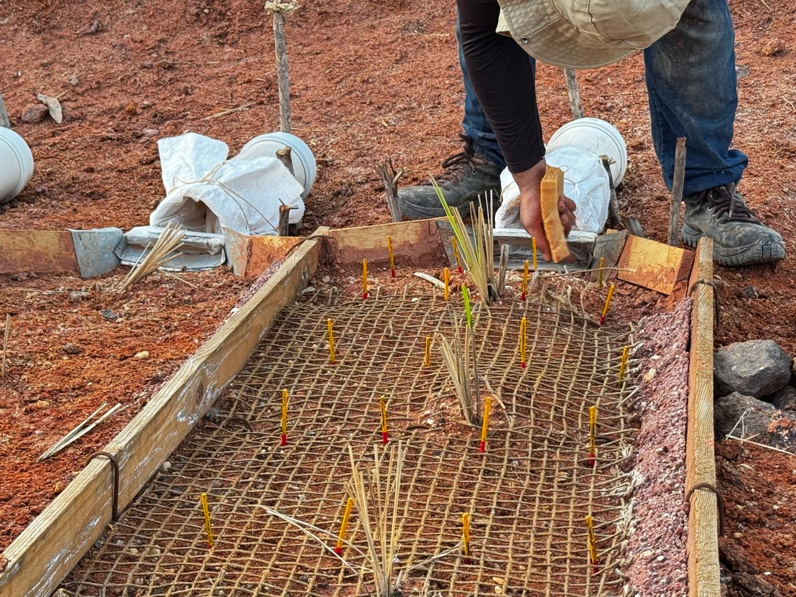

A margem do Baixo São Francisco concentra feições erosivas de magnitude expressiva, condicionadas pela combinação de Plintossolos com baixa coesão efetiva, declividades acentuadas em taludes fluviais e um regime de precipitação que, embora sazonal, produz eventos de erosividade elevada. A unidade técnica de referência desenvolvida pelo grupo PLANeT-Inova/UEFS constitui um laboratório de campo permanente onde diferentes configurações de geossintéticos biodegradáveis são testadas sob condições reais, fornecendo dados de desempenho comparáveis e auditáveis para a tomada de decisão em projetos de recuperação de áreas degradadas.

::: {layout-ncol=2}
{fig-alt="Talude exposto com erosão visível no Baixo São Francisco"}

{fig-alt="Processo erosivo avançado em talude do Baixo São Francisco"}
:::

## Retaludamento como etapa fundamental

A reconfiguração geométrica da encosta constitui a etapa inicial do protocolo. O perfil original, frequentemente com inclinações superiores a 45°, é mecanicamente reperfilado para uma relação 1V:2H (26,6°) ou inferior, compatível com a análise de estabilidade do material local. O material removido é redistribuído na base para formação de bermas de equilíbrio que atenuam o empuxo e favorecem a drenagem subsuperficial.

{fig-alt="Operação de retaludamento em encosta degradada" width="80%"}

## Geotêxteis de fibras naturais

Sobre o talude reperfilado, mantas de geotêxtil confeccionadas com fibras de sisal constituem a primeira camada de proteção. Esses materiais operam como barreira permeável que dissipa a energia cinética da chuva (splash erosion), reduz a velocidade do escoamento superficial e cria um microclima favorável à germinação, enquanto sua biodegradabilidade programada (2 a 5 anos) coincide com o período de estabelecimento radicular da vegetação permanente.

::: {layout-ncol=2}
{fig-alt="Fibra de sisal para confecção de geotêxteis"}

{fig-alt="Geotêxteis de fibras naturais expostos em campo experimental"}
:::

::: {layout-ncol=2}
{fig-alt="Geotêxteis em estágio avançado de biodegradação"}

{fig-alt="Detalhe da malha do geotêxtil de fibras naturais"}
:::

## Geocompostos híbridos e geogrid

Em áreas de maior solicitação mecânica e hídrica, geocompostos híbridos Typha-rami com núcleos de Bio-SAP substituem os geotêxteis simples. Esses geocompostos integram reforço mecânico, proteção antissubversiva e gestão hídrica ativa em um único componente, alcançando capacidade de retenção de água superior a 300% e liberação controlada de nutrientes.

::: {layout-ncol=2}
{fig-alt="Geocomposto instalado sobre talude reperfilado"}

{fig-alt="Detalhe do geocomposto híbrido com malha de reforço e núcleo hidroretentor"}
:::

O geogrid de rami confere reforço estrutural à camada superficial do solo e permite o crescimento da vegetação através das aberturas da malha, criando uma ancoragem progressiva entre o sistema radicular e a estrutura geossintética.

{fig-alt="Geogrid de fibra natural com vegetação emergente em campo experimental" width="80%"}

## Geocélulas e confinamento tridimensional

O sistema de geocélulas introduz uma abordagem de confinamento tridimensional para áreas críticas onde o solo solto necessita de estruturação imediata. As células interconectadas, preenchidas com solo e material vegetal, formam uma malha rígida que impede o deslizamento e promove condições de enraizamento dentro de cada compartimento.

::: {layout-ncol=3}
{fig-alt="Geocélula instalada em campo para controle de erosão"}

{fig-alt="Geocélulas preenchidas com solo e vegetação"}

{fig-alt="Detalhe da estrutura tridimensional das geocélulas"}
:::

::: {layout-ncol=3}
{fig-alt="Geocélulas com vegetação em desenvolvimento"}

{fig-alt="Geocélulas com vegetação estabelecida"}

{fig-alt="Vista panorâmica do sistema de geocélulas"}
:::

## Técnicas complementares e revegetação

Cordões de contorno e paliçadas, dispostos ao longo das curvas de nível, interceptam o escoamento superficial e reduzem a velocidade da água, complementando a proteção oferecida pelos geossintéticos e promovendo deposição preferencial de sedimentos a montante.

::: {layout-ncol=3}
{fig-alt="Construção de cordão de contorno em área experimental"}

{fig-alt="Cordão de contorno instalado em encosta"}

{fig-alt="Vista panorâmica dos cordões de contorno"}
:::

{fig-alt="Área revegetada com protocolo integrado de NBS" width="80%"}

## Resultados de campo

Os resultados consolidados da unidade técnica evidenciam redução mensurável da perda de solo em áreas críticas do Baixo São Francisco, com desempenho diferenciado conforme a configuração testada. A redução de 40 a 60% na perda de solo por erosão hídrica foi acompanhada por custo até 30% inferior comparado a soluções convencionais (muros de arrimo, gabiões, enrocamento) e estabelecimento vegetal em 90% da área tratada. A biodegradação controlada dos geossintéticos em 2 a 5 anos não gera microplásticos, e a remoção de taboa invasora de corpos d'água eutrofizados para uso como matéria-prima proporciona duplo serviço ambiental.

{fig-alt="Canal de escoamento com geossintéticos para controle de erosão" width="80%"}

---

*Para saber mais, confira os posts sobre [Retaludamento como NBS](/posts/nbs-retaludamento/), [Geocompostos Hidrorretentores Typha-Rami](/posts/geocompostos-hidrorretentores-typha-rami/), [Bio-SAP: Biopolímero de Taboa](/posts/bio-sap-biopolimero-taboa/) e [Vida Útil de Geotêxteis de Taboa](/posts/vida-util-geotexteis-taboa/). Visite também nossas [publicações](/papers/) e [projetos](/#projetos).*
