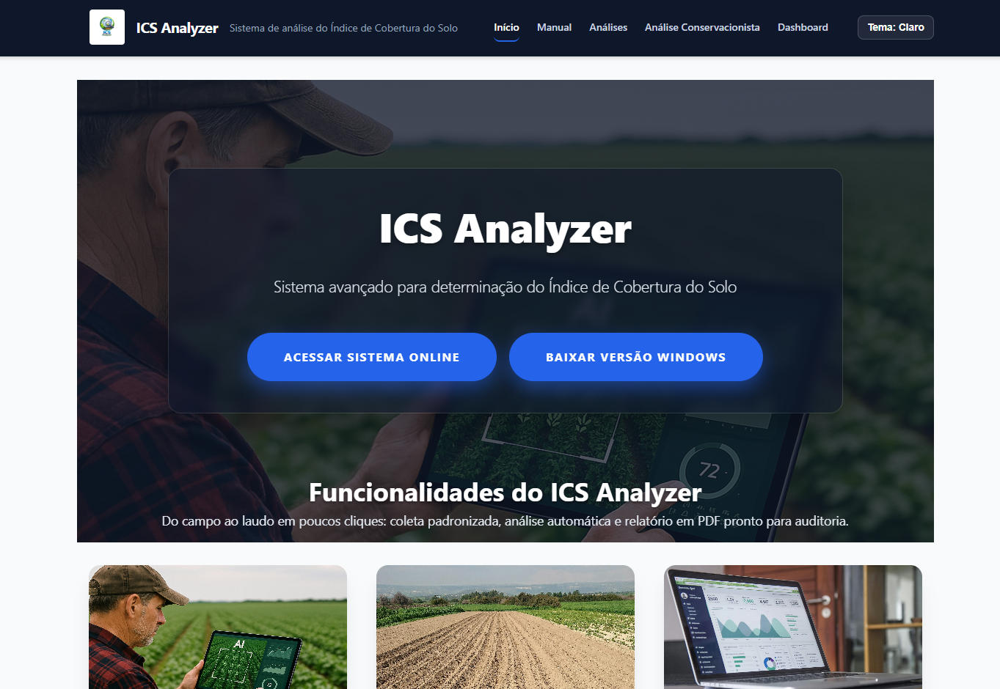

A avaliação quantitativa da cobertura do solo é fundamental para o manejo conservacionista, o controle de erosão e o planejamento do uso da terra. O **ICS Analyzer** é um sistema avançado, multiplataforma, que integra coleta digital padronizada, processamento estatístico, modelos de machine learning e geração automática de laudos técnicos - do campo ao relatório em poucos cliques.

{fig-alt="Interface principal do ICS Analyzer" width="80%"}

## Funcionalidades principais

### Coleta Digital Padronizada

Interface otimizada para o registro de vetores de leitura em campo, eliminando a transcrição manual e garantindo a integridade dos dados primários com validação imediata durante a amostragem.

### Diagnóstico Estrutural em Tempo Real

Algoritmos de processamento instantâneo calculam o Índice de Cobertura do Solo (ICS), desvio padrão e coeficiente de variação, permitindo a tomada de decisão agronômica ainda no local da avaliação.

### Documentação Técnica Automatizada

Geração automática de laudos técnicos em PDF de alta resolução, compilando gráficos de dispersão, análises estatísticas e metadados do projeto em documento pronto para auditoria.

### Análise Conservacionista (ISPC)

Modelo ISPC (*Índice de Solo para Práticas Conservacionistas*) com **10 variáveis informadas** e **5 estimadas**, entregando diagnóstico fuzzy em escala 0-10 e exportação direta para PDF. Suporta histórico anual com planilha organizada por ano.

## Arquitetura e pipeline de machine learning

O ICS Analyzer é sustentado por um pipeline robusto de engenharia de dados e machine learning em Python:

```
Dados CSV → Padronização → Tuning de Hiperparâmetros → Treinamento → Qualidade & Alertas → Dashboard Web
```

### Módulos do pipeline

| Módulo | Função |
|--------|--------|
| `ispc_pipeline.py` | Processamento e padronização de dados |
| `ispc_tune_reduced_ml_advanced.py` | Tuning de hiperparâmetros com validação cruzada |
| `ispc_train_reduced_ml_advanced.py` | Treinamento avançado de modelos |
| `ispc_promote_reduced_ml.py` | Promoção de modelo para produção |
| `ispc_model_quality_report.py` | Relatório de qualidade de modelos |
| `ispc_model_quality_alerts.py` | Sistema de alertas automáticos |
| `ispc_refresh_dashboard_artifacts.py` | Orquestrador do pipeline completo |

: {.striped .hover}

O treinamento utiliza **Regressão Ridge** com validação cruzada K-Fold e Group K-Fold, permitindo estimativa robusta de variáveis de solo a partir de um conjunto reduzido de entradas.

## Engenharia de software

O projeto seguiu princípios rigorosos de engenharia de software, com refatoração completa da base de código:

- **DRY (Don't Repeat Yourself):** redução de ~40% de duplicação com módulos compartilhados (`ispc_common.py`)
- **Configurações centralizadas** via `ispc_config.py` (sem hardcoding)
- **Logging padronizado** com `ispc_logging.py`
- **Tratamento estruturado de erros** com exceções personalizadas (`ispc_errors.py`)
- **I/O robusto** via `ispc_io.py` com validação automática
- **100% de docstrings** e **100% de type hints**
- **12 testes unitários** + teste de integração com dados sintéticos

| Métrica | Antes | Depois |
|---------|-------|--------|
| Duplicação de código | ~40% | <10% |
| Linhas por função | 80-150 | <50 |
| Docstrings | ~30% | 100% |
| Type hints | ~50% | 100% |

: {.striped .hover}

## Dashboard Web e aplicação Desktop

O sistema oferece duas modalidades de uso:

- **Web (GitHub Pages):** dashboard interativo HTML/CSS/JS puro hospedado estaticamente, acessível de qualquer navegador, sem backend. Inclui páginas de análise, manual, análise conservacionista de longo prazo e dashboard de métricas.
- **Desktop (Electron):** aplicação instalável para Windows com todas as funcionalidades offline, empacotada via GitHub Actions com release automatizado.

## CI/CD e automação

O ciclo completo de integração contínua é implementado via **GitHub Actions**:

- **Refresh de artefatos:** o workflow `ispc-refresh-artifacts.yml` encadeia tuning, promoção para produção, relatório de qualidade e alertas automaticamente.
- **Release Desktop:** o workflow `desktop-windows-release.yml` publica instaladores Windows a partir de tags versionadas (`vX.Y.Z`).

## Equipe técnica

| Membro | Instituição | Papel |
|--------|-------------|-------|
| Luiz Diego Vidal Santos | UEFS | Desenvolvedor |
| Alceu Pedrotti | UFS | Pesquisador |
| Francisco S. R. Holanda | UFS | Pesquisador |
| Janderleia Oliveira Ferreira | UFS | Pesquisadora |
| Remisson N. de Araújo Filho | UFRPE | Pesquisador |

: {.striped .hover}

## Acesso e código-fonte

::: {.text-center .mt-3}
[ Sistema Online](https://ldvsantos.github.io/ICS_Analyzer/sistema.html){.btn .btn-primary .btn-lg .me-2 target="_blank"}
[ Código-Fonte](https://github.com/ldvsantos/ICS_Analyzer){.btn .btn-outline-dark .btn-lg .me-2 target="_blank"}
[ Baixar Windows](https://github.com/ldvsantos/ICS_Analyzer/releases/latest/download/ICS-Analyzer-Windows-Installer.zip){.btn .btn-success .btn-lg target="_blank"}
:::

---

*Para saber mais sobre instrumentação e análise de solos, confira os posts sobre [Patente do Aparato Vistada](/posts/patente-vistada-amostra-solo/), [Patente do Amostrador](/posts/patente-amostrador-solo/) e [Patente do Permeâmetro](/posts/patente-permeametro/). Visite os [projetos](/#projetos) para uma visão geral.*
