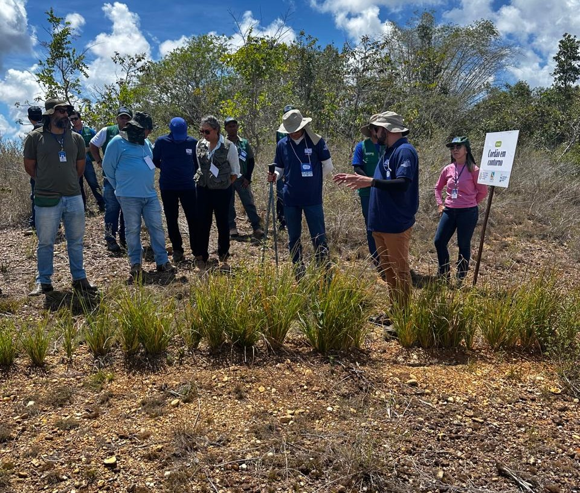
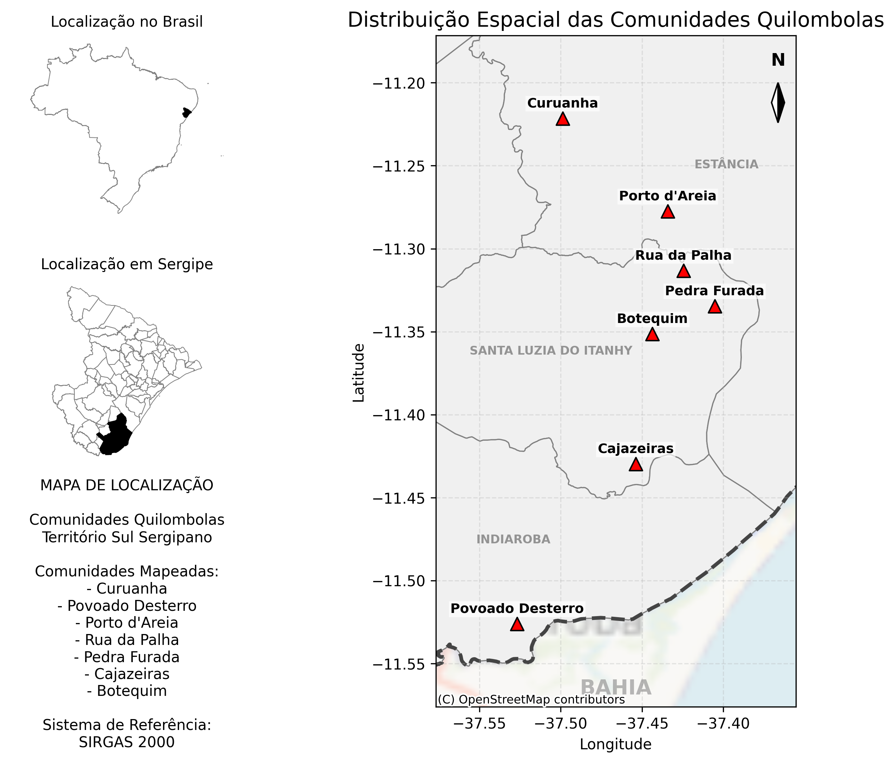
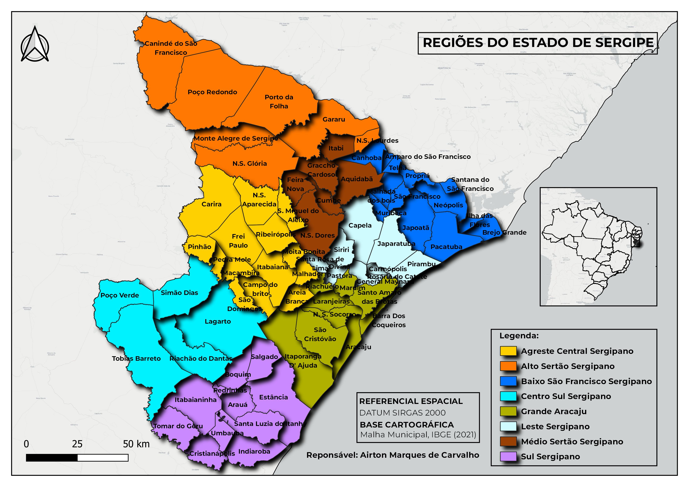
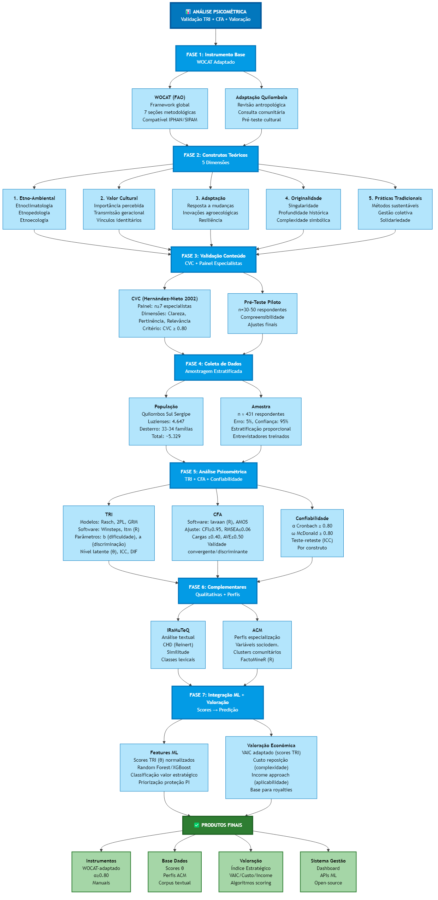
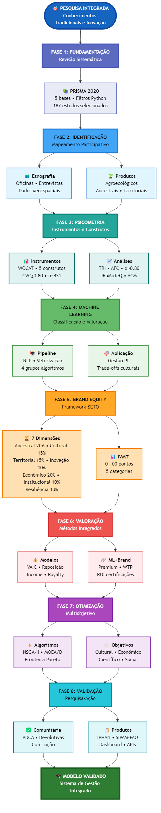

Comunidades tradicionais do Semiárido nordestino mantêm, ao longo de gerações, um repertório de saberes agrícolas cuja complexidade e adaptabilidade superam a lógica da transferência tecnológica convencional. Técnicas de convivência com a seca, manejo de sementes crioulas, policultivos consorciados e calendários agronômicos orientados por indicadores ambientais locais configuram um acervo de conhecimento tácito que permanece invisível aos instrumentos formais de valoração econômica e proteção jurídica. A ausência de mecanismos adequados de mensuração, registro e governança desse patrimônio expõe as comunidades a assimetrias de mercado e ao risco de apropriação indevida por terceiros.

{fig-alt="Pesquisa de campo sobre sistemas agrícolas tradicionais no Semiárido" width="80%"}

## Fundamentação e marco teórico

O projeto ancora-se na Resource-Based View (RBV), que posiciona o conhecimento tradicional como ativo intangível dotado de valor, raridade, inimitabilidade e não-substitutibilidade. A teoria das Capacidades Dinâmicas complementa essa lente ao enfatizar que a sustentabilidade do ativo depende da capacidade comunitária de detectar oportunidades (sensing), capturar valor (seizing) e adaptar-se a mudanças institucionais (transforming). A externalização do conhecimento tácito, conforme o modelo de Nonaka (1995), exige instrumentos que convertam práticas observáveis em variáveis mensuráveis sem descaracterizar o saber original, condição que a Lógica Fuzzy (Zadeh, 1965) atende ao permitir a representação de ambiguidade e gradação em construtos qualitativos.

::: {layout-ncol=2}
{fig-alt="Mapa das comunidades quilombolas do Sul de Sergipe"}

{fig-alt="Território de estudo no Sul de Sergipe"}
:::

## Metodologia e design instrumental

O protocolo metodológico opera em cinco etapas encadeadas. Na primeira, a adaptação transcultural do instrumento WOCAT-SLM gera uma escala multidimensional com cinco construtos calibrados por análise psicométrica baseada em Teoria de Resposta ao Item (TRI). Na segunda, um painel Delphi com especialistas em etnobiologia, propriedade intelectual e engenharia de biossistemas valida os pesos dos construtos e os limiares de classificação. Na terceira, o modelo de valoração TRI-VAIC integrado com Lógica Fuzzy produz o Índice de Valoração Bioeconômica (IVB), que traduz saberes qualitativos em escores auditáveis para cada comunidade. Na quarta, experimentos de sinalização de mercado com selos de valoração bioeconômica testam a variação de willingness to pay em cenários simulados. Na quinta, o design participativo converte os resultados em protocolo de governança territorial ancorado nas comunidades.

{fig-alt="Análise psicométrica do instrumento de avaliação de saberes tradicionais" width="80%"}

## Hipóteses e resultados esperados

O projeto investiga cinco hipóteses complementares. A primeira postula que o protocolo de governança proposto reduz custos de transação para registro de patrimônio genético e conhecimento tradicional associado junto ao SisGen/CGen. A segunda prevê que o método Delphi estruturado produz índice de consenso estatisticamente superior a levantamentos qualitativos convencionais. A terceira prediz que o IVB calculado via Lógica Fuzzy supera a regressão linear múltipla na explicação da variabilidade dos saberes, dada a natureza não-linear e ambígua das variáveis. A quarta hipótese testa se o selo de valoração aumenta significativamente a disposição a pagar por produtos derivados de sistemas agrícolas tradicionais em cenários experimentais. A quinta avalia se a construção participativa do sistema eleva a taxa de adoção continuada da tecnologia pelas comunidades.

{fig-alt="Fluxo de processos do protocolo de governança bioeconômica" width="80%"}

## Relevância e impacto territorial

O mapeamento de comunidades tradicionais e a criação de um protocolo de salvaguarda inédito no Brasil configuram o principal resultado concreto do projeto. Ao converter conhecimento tácito em índices auditáveis e rastreáveis, o sistema permite que gestores territoriais e formuladores de políticas públicas identifiquem hotspots de patrimônio biocultural ameaçado, priorizem investimentos em conservação ativa e criem mecanismos de repartição de benefícios compatíveis com a Convenção sobre Diversidade Biológica e o Protocolo de Nagoia. Para as comunidades quilombolas do Sul de Sergipe, o protocolo representa uma ferramenta de empoderamento econômico e jurídico que formaliza a titularidade sobre saberes historicamente invisibilizados.

---

*Para saber mais, confira os posts sobre [Propriedade Intelectual no Agro](/posts/pi-agro-inovacao/), [Terroir Digital e Machine Learning](/posts/terroir-digital-ml/) e [Índice Fuzzy de Sustentabilidade](/posts/indice-fuzzy-sustentabilidade/). Visite também nossas [publicações](/papers/) e [projetos](/#projetos).*
